# Data Model

> REA: infer entities, fields, types and relationships from observed behavior.
> Rules: money = integer minor units; all PKs = UUID; timestamps = UTC; soft-delete where history matters.

**Basis.** The reference app keeps a local database. Its table/DAO names were observed (static): person, friendship, friendship balance, group, group member, group member balance, group repayment, expense, share (a per-person row on an expense), expense comment, category, currency, notification, plus fintech tables (card, funding source, funds flow) that are out of scope. It has 36 schema versions. That tells us **which entities exist and how they relate**. Column names, types and constraints below are **our own design** for PostgreSQL. They are not taken from the reference schema.

Conventions:
- `uuid` PKs generated by the app (uuid4; v7 later if needed). `timestamptz` everywhere, stored in UTC.
- Money: `bigint` minor units + `char(3)` currency. **No `numeric`/`float` columns hold money.** The only non-integer numeric is `exchange_rates.rate` (`numeric(18,8)`), which is used only by the convert action.
- Soft delete: `deleted_at timestamptz null` and `deleted_by uuid null` on groups, expenses and settlements. `users` and `comments` have `deleted_at` only (users are anonymised). `friendships` use `status` + `removed_at` instead.
- Optimistic locking: `version int not null default 1` on expenses, settlements and groups.
- Every table has `created_at` and `updated_at` (`timestamptz not null default now()`). They are listed once here and omitted from the tables below.

## ER summary

```mermaid
erDiagram
  USER ||--o{ GROUP_MEMBER : joins
  GROUP ||--o{ GROUP_MEMBER : has
  GROUP ||--o{ EXPENSE : contains
  GROUP ||--o{ SETTLEMENT : contains
  GROUP ||--o{ GROUP_INVITE : has
  GROUP ||--o{ USER_GROUP_DEFAULT_SPLIT : has
  EXPENSE ||--o{ EXPENSE_PAYER : paid_by
  EXPENSE ||--o{ EXPENSE_SPLIT : owed_by
  EXPENSE ||--o{ COMMENT : has
  EXPENSE ||--o{ RECEIPT : has
  EXPENSE }o--|| CATEGORY : in
  EXPENSE }o--|| CURRENCY : in
  EXPENSE }o--o| RECURRING_RULE : generated_by
  RECURRING_RULE }o--|| EXPENSE : templated_from
  CATEGORY ||--o{ CATEGORY : parent_of
  USER ||--o{ EXPENSE_PAYER : pays
  USER ||--o{ EXPENSE_SPLIT : owes
  USER ||--o{ SETTLEMENT : sends
  USER ||--o{ SETTLEMENT : receives
  USER ||--o{ FRIENDSHIP : has
  USER ||--o{ COMMENT : writes
  USER ||--o{ REFRESH_TOKEN : holds
  USER ||--o{ PASSWORD_RESET_TOKEN : requests
  USER ||--o{ USER_EMAIL : owns
  USER ||--o{ IDEMPOTENCY_KEY : sends
  ACTIVITY_LOG ||--o{ ACTIVITY_RECIPIENT : shown_to
  USER ||--o{ ACTIVITY_RECIPIENT : sees
  USER ||--o{ PUSH_DEVICE : registers
  USER ||--o{ NOTIFICATION : receives
  USER ||--o{ ACTIVITY_LOG : acts
  USER ||--o| SUBSCRIPTION : has
  USER ||--o{ EXPORT : requests
  USER ||--o{ REMINDER : sends
  CURRENCY ||--o{ EXCHANGE_RATE : quoted
```

## Entities

### users
| Field | Type | Null | Notes |
|---|---|---|---|
| id | uuid | no | PK |
| email | citext | yes | unique when not null; null only for phone-only placeholders |
| phone_e164 | varchar(16) | yes | unique when not null |
| name | text | no | 1–100 chars |
| password_hash | text | yes | argon2id; null for placeholders and Google-only users |
| is_registered | bool | no | false = placeholder created by an invite (F-09) |
| default_currency | char(3) | no | ISO 4217, FK → currencies.code |
| time_zone | text | no | IANA, default `Asia/Kolkata` (**decision**) |
| locale | varchar(10) | no | default `en-IN` |
| avatar_url | text | yes | object-storage key |
| notification_prefs | jsonb | no | `{ "expense_added": true, ... }`, the 10 keys of F-38 |
| activity_last_read_at | timestamptz | yes | drives `is_unread` and `ActivityPage.unread_count` (see Derived data); null = nothing read yet; set to now by `POST /activity/read` |
| friend_code | varchar(16) | no | unique, random; personal add-friend link / QR (F-10) |
| google_sub | text | yes | unique; V2 |
| invited_by | uuid | yes | FK → users.id (placeholders) |
| merged_into | uuid | yes | FK → users.id; set when a placeholder is merged (OQ-24) |
| created_at | timestamptz | no | |
| deleted_at | timestamptz | yes | account deletion → PII nulled, name becomes "Deleted user" |

### user_emails (V2: secondary emails added by "merge accounts")
| Field | Type | Null | Notes |
|---|---|---|---|
| user_id | uuid | no | FK users, PK part |
| email | citext | no | PK part, globally unique |
| verified_at | timestamptz | yes | |

### refresh_tokens
| Field | Type | Null | Notes |
|---|---|---|---|
| id | uuid | no | PK (`jti`) |
| user_id | uuid | no | FK users, index |
| token_hash | bytea | no | SHA-256 of the opaque token |
| device_label | text | yes | |
| expires_at | timestamptz | no | created + 30 days |
| revoked_at | timestamptz | yes | set when the token stops being usable: rotation on refresh, logout, reuse detection or a password reset |
| revoked_reason | text | yes | null while live (`revoked_at is null`). Check `revoked_reason in ('rotated','logout','reuse_detected','password_reset')`, and `(revoked_at is null) = (revoked_reason is null)`. Added by Alembic migration 0002 (task S1-B-7); existing revoked rows are backfilled as `rotated` (the only way a token could be revoked before 0002 was rotation, logout or reuse detection, which cannot be told apart afterwards, so the backfill is the conservative choice that keeps reuse detection active for them) |

Reason semantics (business_rules §11): `rotated` = replaced by a refresh; presenting it again is reuse and revokes all of the user's live tokens (those get `reuse_detected`). `logout` = revoked by `POST /auth/logout`; presenting it again returns 401 `TOKEN_INVALID` and changes nothing else. `reuse_detected` = revoked as collateral of a reuse event. `password_reset` = revoked by a successful password reset. Presenting a token whose reason is `reuse_detected`, `password_reset` or `logout` never triggers another revoke-all.

### idempotency_keys
Backs the `Idempotency-Key` header on every endpoint that accepts it (POST /friends, /groups, /groups/{id}/expenses, /expenses, /settlements). The unique `(created_by, idempotency_key)` columns on `expenses` and `settlements` stay as a second line of defence against duplicate rows.
| Field | Type | Null | Notes |
|---|---|---|---|
| user_id | uuid | no | PK part, FK users |
| key | uuid | no | PK part, the header value |
| method_path | text | no | e.g. `POST /groups`; a key reused on a different endpoint returns 422 `VALIDATION_ERROR` |
| response_status | smallint | no | stored response, replayed on repeat |
| response_body | jsonb | no | |
| created_at | timestamptz | no | rows purged after 24 h |

### password_reset_tokens
| Field | Type | Null | Notes |
|---|---|---|---|
| id | uuid | no | PK |
| user_id | uuid | no | FK users |
| token_hash | bytea | no | unique |
| expires_at | timestamptz | no | +60 min |
| used_at | timestamptz | yes | single use |

### groups
| Field | Type | Null | Notes |
|---|---|---|---|
| id | uuid | no | PK |
| name | text | no | 1–100 chars |
| group_type | text | no | check in (`home`,`trip`,`couple`,`other`) |
| simplify_debts | bool | no | default true (OQ-09) |
| default_currency | char(3) | no | FK currencies |
| avatar_url | text | yes | |
| trip_start_date | date | yes | only when type = trip |
| trip_end_date | date | yes | check end ≥ start |
| whiteboard | text | yes | ≤ 10000 chars (Later) |
| whiteboard_updated_by | uuid | yes | FK users |
| created_by | uuid | no | FK users |
| version | int | no | optimistic lock |
| deleted_at | timestamptz | yes | soft delete, restorable (F-16) |
| deleted_by | uuid | yes | |

### group_members
| Field | Type | Null | Notes |
|---|---|---|---|
| group_id | uuid | no | PK part, FK groups |
| user_id | uuid | no | PK part, FK users |
| role | text | no | `member` only in MVP (OQ-10); `admin` reserved |
| sort_index | int | no | join order, starting at 0 for the creator; members added in one request take the next values in request order (`member_user_ids` first, then `new_members`). Defines the **canonical order** for remainder distribution (business_rules §1, §2.1) |
| joined_at | timestamptz | no | |
| left_at | timestamptz | yes | set on leave/remove; rejoining sets it back to null and keeps the original `sort_index` |
| added_by | uuid | yes | FK users |

### group_invites
| Field | Type | Null | Notes |
|---|---|---|---|
| id | uuid | no | PK |
| group_id | uuid | no | FK groups; at most 1 active row per group (partial unique index on `revoked_at is null`) |
| token | varchar(32) | no | unique, URL-safe random |
| created_by | uuid | no | |
| revoked_at | timestamptz | yes | reset link |

### user_group_default_splits (V2, F-27)
| Field | Type | Null | Notes |
|---|---|---|---|
| user_id | uuid | no | PK part (the owner of the preference) |
| group_id | uuid | no | PK part |
| split_type | text | no | `equal`/`percent`/`shares` |
| entries | jsonb | no | `[{"user_id":..,"value":int}]`; percent in basis points, shares as integers |

### friendships
| Field | Type | Null | Notes |
|---|---|---|---|
| user_id | uuid | no | PK part; always the **smaller** uuid of the pair |
| friend_id | uuid | no | PK part; the larger uuid. Check `user_id < friend_id` |
| status | text | no | `active`, `removed`, `blocked` |
| blocked_by | uuid | yes | which side blocked |
| created_at | timestamptz | no | |
| removed_at | timestamptz | yes | |

One row per pair (symmetric relationship), unique on `(user_id, friend_id)` (the primary key). Rows are written for explicit friendships (friend code, email, phone or personal link) **and** by materialization when the last shared group of a pair ends (below). **Decided 2026-11-07 (OQ-33):** implicit friendships are not stored while a group is live, because a 200-member group would need 19,900 rows. **Decided 2026-11-10 (OQ-37a):** when a pair loses its last shared non-deleted group (member leaves, member removed, group soft-deleted) the pair is written as an `active` row in the same transaction, so ex-co-members stay in the list.

The **friend list** of user U is computed at read time as: explicit friends (`status = 'active'` rows involving U) UNION every user who shares at least one non-deleted group (`groups.deleted_at is null`, both `group_members.left_at is null`) with U. Needs the index `group_members (user_id, group_id)` (partial `where left_at is null`). Consequences:
- While a group is shared, an implicit friend has no `friendships` row, so it cannot be removed (`DELETE /friends/{id}` -> 409 `SHARED_GROUPS_EXIST`). It does not disappear when the last shared group ends: see "Materialization" below.
- A non-group expense does not create a friendship row. Its users must already be friends (explicit or implicit) when it is created; because ending friendships are materialized, such expenses never lose their friend list entry (business_rules §10.1a).
- **Materialization (business_rules §10.1a).** In the transaction of `DELETE /groups/{id}/members/{user_id}` or `DELETE /groups/{id}`, each candidate pair that now shares no other non-deleted group is upserted with `(user_id, friend_id) = (least, greatest)`: insert `status = 'active'`; existing `active` row unchanged; existing `removed` row set to `active` with `removed_at = null` (`created_at` kept); `blocked` untouched. Suggested statement: `INSERT ... ON CONFLICT (user_id, friend_id) DO UPDATE SET status = 'active', removed_at = NULL WHERE friendships.status = 'removed'`. No `activity_log`, `activity_recipients` or `notifications` rows are written. Restoring a group does not delete the rows. No new column, table or index is needed.
- Removing an explicit friend sets `status = 'removed'` and `removed_at` and soft-deletes both the non-group expenses and the non-group settlements involving only the two users (decided 2026-11-09, OQ-37b); if the two still share a group they remain in each other's list via the group, but removal is refused in that case anyway (409 `SHARED_GROUPS_EXIST`).

### categories
| Field | Type | Null | Notes |
|---|---|---|---|
| id | smallint | no | PK (seeded, stable ids) |
| parent_id | smallint | yes | FK categories; null = top level |
| slug | text | no | unique, e.g. `transport.taxi` |
| name | text | no | our own wording |
| icon | text | no | our own icon key |
| sort_index | smallint | no | |

Seed: 7 parents (Entertainment, Food & drink, Home, Life, Transport, Utilities, General) with about 40 children; id 1 = General → Uncategorized (default). The list is our own (OQ-D3).

### currencies
| Field | Type | Null | Notes |
|---|---|---|---|
| code | char(3) | no | PK, ISO 4217 |
| name | text | no | |
| symbol | text | no | |
| exponent | smallint | no | 0, 2 or 3 (JPY 0, INR 2, KWD 3) |
| is_active | bool | no | |

### exchange_rates (Later, F-44)
| Field | Type | Null | Notes |
|---|---|---|---|
| base | char(3) | no | PK part |
| quote | char(3) | no | PK part |
| as_of | date | no | PK part |
| rate | numeric(18,8) | no | units of `quote` per 1 `base`; **not money** |
| source | text | no | provider name (OQ-17) |

### expenses
| Field | Type | Null | Notes |
|---|---|---|---|
| id | uuid | no | PK |
| group_id | uuid | yes | FK groups; null = non-group expense |
| description | text | no | 1–200 chars |
| total_amount_minor | bigint | no | check `> 0 and <= 9999999999` |
| currency | char(3) | no | FK currencies |
| category_id | smallint | no | FK categories, default 1 |
| notes | text | yes | ≤ 2000 |
| expense_date | date | no | the user's local date (no time) |
| split_type | text | no | `equal`,`exact`,`percent`,`shares`,`adjustment`, plus `itemized` (Later) |
| created_by | uuid | no | FK users |
| updated_by | uuid | yes | |
| recurring_rule_id | uuid | yes | FK recurring_rules (the FK is added by the recurring migration; the column exists from the expenses migration). Set on every occurrence **including the template expense itself**, which is set after the rule row is inserted (deferred FK) |
| occurrence_date | date | yes | unique with recurring_rule_id; the template expense has `occurrence_date = anchor_date`, so the scheduler never regenerates it |
| fx_original_amount_minor | bigint | yes | set by currency conversion |
| fx_original_currency | char(3) | yes | |
| fx_rate | numeric(18,8) | yes | |
| idempotency_key | uuid | yes | unique per created_by; offline replay (F-53) |
| version | int | no | |
| deleted_at | timestamptz | yes | |
| deleted_by | uuid | yes | |

### expense_payers
| Field | Type | Null | Notes |
|---|---|---|---|
| expense_id | uuid | no | PK part, FK expenses on delete cascade |
| user_id | uuid | no | PK part (so a payer can't repeat, F-26) |
| paid_amount_minor | bigint | no | check `> 0` |

### expense_splits
| Field | Type | Null | Notes |
|---|---|---|---|
| expense_id | uuid | no | PK part |
| user_id | uuid | no | PK part |
| owed_amount_minor | bigint | no | check `>= 0`; the computed result, which is what balances use |
| input_value | bigint | yes | the raw input per split type: exact = minor units; percent = basis points (3333 = 33.33%); shares = integer shares; adjustment = minor units; equal = null |
| sort_index | smallint | no | the participant's position (0..n-1) in the canonical order at write time, computed by the server per business_rules §1 (group expense: by `group_members.sort_index`; non-group: creator first, then ascending `user_id`). Request order is ignored. Stored so a recompute reproduces the same result |

Rows exist for every participant, including people who owe 0 in exact/adjustment splits but are "involved". A payer who owes nothing (not in the split) has **no** split row (business_rules §8).

### settlements
| Field | Type | Null | Notes |
|---|---|---|---|
| id | uuid | no | PK |
| group_id | uuid | yes | null = non-group |
| from_user_id | uuid | no | the payer (debtor), FK users |
| to_user_id | uuid | no | the receiver, check `<> from_user_id` |
| amount_minor | bigint | no | check `> 0 and <= 9999999999` |
| currency | char(3) | no | |
| settled_on | date | no | |
| note | text | yes | ≤ 500 |
| method | text | no | `cash` only (others out of scope) |
| created_by | uuid | no | may be either party or any group member |
| batch_id | uuid | yes | links settlements created by one "settle all" |
| idempotency_key | uuid | yes | unique per created_by; offline replay (F-53) |
| version | int | no | |
| deleted_at | timestamptz | yes | |
| deleted_by | uuid | yes | |

### recurring_rules (V2, F-40)
| Field | Type | Null | Notes |
|---|---|---|---|
| id | uuid | no | PK |
| template_expense_id | uuid | no | FK expenses; the first occurrence; its payers and splits are the template |
| interval | text | no | `weekly`,`fortnightly`,`monthly`,`yearly` |
| anchor_date | date | no | the first occurrence date; day-of-month is clamped from this |
| next_occurrence_date | date | no | index, scanned by the scheduler |
| reminder_days_before | smallint | yes | null = none; 0 = on the day |
| time_zone | text | no | the creator's IANA zone at creation |
| active | bool | no | |
| created_by | uuid | no | |

### comments
| Field | Type | Null | Notes |
|---|---|---|---|
| id | uuid | no | PK |
| expense_id | uuid | yes | FK expenses (exactly one of expense_id / settlement_id is set) |
| settlement_id | uuid | yes | FK settlements. Reserved: openapi v0.1.1 exposes comments on expenses only |
| user_id | uuid | yes | null for system comments |
| kind | text | no | `user` or `system` |
| body | text | no | 1–1000 chars |
| deleted_at | timestamptz | yes | |

### receipts (V2, F-28)
| Field | Type | Null | Notes |
|---|---|---|---|
| id | uuid | no | PK |
| expense_id | uuid | no | FK expenses; at most 1 active per expense (MVP) |
| storage_key | text | no | object storage |
| content_type | text | no | `image/jpeg` or `image/png` only (matches openapi). `application/pdf` is reserved, pending OQ-26 |
| size_bytes | int | no | ≤ 10 MB |
| uploaded_by | uuid | no | |
| ocr_payload | jsonb | yes | Later (F-49) |

### activity_log
| Field | Type | Null | Notes |
|---|---|---|---|
| id | uuid | no | PK |
| actor_id | uuid | yes | null = system (recurring job) |
| action | text | no | exactly the `ActivityItem.action` enum in openapi: `expense.created`, `expense.updated`, `expense.deleted`, `expense.restored`, `settlement.created`, `settlement.updated`, `settlement.deleted`, `settlement.restored`, `comment.created`, `group.created`, `group.updated`, `group.deleted`, `group.restored`, `group.member_added`, `group.member_removed`, `group.member_joined`, `friend.added`, `friend.removed`, `group.currency_converted` |
| entity_type | text | no | `expense`, `settlement`, `group`, `friendship`, `comment` |
| entity_id | uuid | no | |
| group_id | uuid | yes | for filtering |
| payload | jsonb | no | snapshot: description, totals before/after, per-user deltas |
| created_at | timestamptz | no | index (created_at desc) |

### activity_recipients
| Field | Type | Null | Notes |
|---|---|---|---|
| activity_id | uuid | no | PK part |
| user_id | uuid | no | PK part; index (user_id, activity_id desc) for the feed |
| balance_effect | jsonb | yes | `[{currency, amount_minor}]` for "you owe / you get back" |

### notifications (outbox for push and email)
| Field | Type | Null | Notes |
|---|---|---|---|
| id | uuid | no | PK |
| user_id | uuid | no | recipient |
| type | text | no | one of the 10 F-38 types, or `reminder`, `invite`, `password_reset` |
| channel | text | no | `push` or `email` |
| activity_id | uuid | yes | |
| payload | jsonb | no | |
| status | text | no | `pending`,`sent`,`failed`,`skipped_pref` |
| attempts | smallint | no | |
| sent_at | timestamptz | yes | |

### push_devices
| Field | Type | Null | Notes |
|---|---|---|---|
| id | uuid | no | PK |
| user_id | uuid | no | |
| platform | text | no | `android` |
| token | text | no | unique |
| last_seen_at | timestamptz | no | |

### reminders (F-39)
| Field | Type | Null | Notes |
|---|---|---|---|
| id | uuid | no | PK |
| from_user_id | uuid | no | |
| to_user_id | uuid | no | |
| group_id | uuid | yes | |
| message | text | yes | ≤ 1000 |
| sent_at | timestamptz | no | rate limit: 1 per (from, to) per 60 s |

### group_reminder_settings (Later, F-41 / F-42)
| Field | Type | Null | Notes |
|---|---|---|---|
| group_id | uuid | no | PK part |
| user_id | uuid | no | PK part (balance alerts are per user) |
| settle_cadence | text | yes | `weekly` / `monthly` |
| settle_day | smallint | yes | weekday 1–7 or day of month 1–31; 31 = last day |
| balance_alert_threshold_minor | bigint | yes | |
| balance_alert_currency | char(3) | yes | |
| balance_alert_armed | bool | no | re-armed when the balance falls back below the threshold |

### subscriptions (F-46)
| Field | Type | Null | Notes |
|---|---|---|---|
| user_id | uuid | no | PK |
| plan | text | no | `free`, `premium_monthly`, `premium_yearly` |
| status | text | no | `active`, `grace`, `expired`, `cancelled` |
| current_period_end | timestamptz | yes | |
| store | text | yes | `google_play` |
| purchase_token_hash | bytea | yes | |

### daily_usage (only if the add-expense cap is adopted; OQ-19)
| Field | Type | Null | Notes |
|---|---|---|---|
| user_id | uuid | no | PK part |
| usage_date | date | no | PK part (in the user's time zone) |
| expenses_created | int | no | |

### exports (F-45)
| Field | Type | Null | Notes |
|---|---|---|---|
| id | uuid | no | PK |
| requested_by | uuid | no | |
| scope | text | no | `group` or `friend` |
| group_id | uuid | yes | |
| friend_id | uuid | yes | |
| format | text | no | `csv` |
| status | text | no | `pending`,`ready`,`failed` |
| storage_key | text | yes | |
| purge_at | timestamptz | yes | created_at + 24 h; the file is deleted then. The API's `expires_at` is a different thing: the expiry of the signed download URL (15 min), computed on each read, not stored |

### Other (REA: add if observed)
All observed extras are covered above: categories, currencies, exchange_rates, recurring_rules, notifications, receipts, plus reminders, subscriptions, exports and default splits. **Not modelled** (out of scope): cards, card transactions, funding sources, funds flows, bank connections.

## Derived data (not stored in MVP)
- **Per-expense net:** `net(u, e) = paid(u, e) − owed(u, e)`.
- **Group balance per user per currency:** the sum of nets over non-deleted expenses in the group, plus settlements (from: +amount, to: −amount). Computed by one SQL aggregate (`UNION ALL` of payers (+), splits (−), settlements from (+), settlements to (−)), grouped by user and currency. Index `(group_id) where deleted_at is null` on expenses and settlements keeps it fast. Add a materialised `balances` table only if p95 latency on `GET /groups/{id}/balances` goes over 200 ms with 5000 expenses (**decision**).
- **Pairwise debts** (simplify off, and for friend balances): see business_rules §4.2.
- **Unread count** (`ActivityPage.unread_count`, decided 2026-11-09, OQ-36): `select count(*) from activity_recipients r join activity_log a on a.id = r.activity_id where r.user_id = :me and (users.activity_last_read_at is null or a.created_at > users.activity_last_read_at)`. Not stored, not capped (the client caps the badge at "99+"), independent of the `group_id` filter and of paging. An item's `is_unread` uses the same predicate, so `unread_count` equals the number of `is_unread = true` items in the whole feed. Uses the `activity_recipients (user_id, activity_id desc)` index plus `activity_log (created_at)`.
- **Group timeline** (`GET /groups/{id}/timeline`, decided 2026-11-09, OQ-35): not stored. A read-time merge of the group's `expenses` (key `expense_date`) and `settlements` (key `settled_on`), ordered by key desc, then `created_at` desc, then `id` desc, with a keyset cursor over `(date, created_at, id)`. Deleted rows are filtered by `deleted_at is null` unless `include_deleted`. Needs `settlements (group_id, settled_on desc, created_at desc, id desc) where deleted_at is null` in the settlements migration (S5-B-1) so the merge can read both sides in index order.
- **`settled_up_since`** (on Friend and GroupSummary): computed on read as the timestamp of the latest non-deleted expense or settlement event after which every balance in the scope is 0, or null if any balance is non-zero or there is no activity. Not stored.

## Indexes and constraints
- `sum(expense_payers.paid_amount_minor) = expenses.total_amount_minor`. Enforced in the service layer within the same transaction, plus a deferred constraint trigger `check_expense_sums` that fires at commit. Tested by property tests.
- `sum(expense_splits.owed_amount_minor) = expenses.total_amount_minor`. Same mechanism.
- For each group and currency: Σ balances over members = 0. A test invariant, not a DB constraint.
- Every `expense_payers.user_id` and `expense_splits.user_id` on a group expense must be a member of that group at the time of writing (`left_at is null`). Service-layer check.
- A non-group expense must include `created_by` as a payer or split participant (F-18 AC7).
- `settlements.from_user_id <> to_user_id` (check constraint).
- `expenses.total_amount_minor between 1 and 9999999999` (check).
- `expense_splits.owed_amount_minor >= 0`, `expense_payers.paid_amount_minor > 0` (checks).
- The `expenses.currency` exponent determines the valid input precision; the API accepts only integer minor units.
- Unique `(recurring_rule_id, occurrence_date)` on expenses.
- Unique `(created_by, idempotency_key)` on expenses and settlements, plus the `idempotency_keys` table for all other endpoints that accept the header.
- Partial unique `group_invites(group_id) where revoked_at is null`.
- `friendships` check `user_id < friend_id`. Rows exist for explicit friendships and for pairs materialized when their last shared group ended (OQ-33, OQ-37a); never for pairs that currently share a group and nothing else.
- Indexes: `group_members(user_id, group_id) where left_at is null` (friend list derivation, OQ-33); `expenses(group_id, expense_date desc) where deleted_at is null`; `expense_splits(user_id)`; `expense_payers(user_id)`; `settlements(group_id)`, `settlements(from_user_id)`, `settlements(to_user_id)`; `activity_recipients(user_id, activity_id desc)`; `recurring_rules(next_occurrence_date) where active`; GIN trigram on `expenses.description` for search (V2).

**Evidence / confidence:**
- Entity set: **high** (the table/DAO names listed above were observed (static)).
- Payer and split rows as separate per-person records on an expense: **high** (a per-person "share" entity, and "one person cannot pay multiple shares").
- Group member balances and group repayments as separate concepts (nets vs suggested payments): **high**.
- Payments represented as their own entity: **medium**. The reference app may store payments as a flagged expense (OQ-27). Our design keeps a separate `settlements` table either way.
- Group types, trip dates, whiteboard and personal default split: **high** (strings and layouts).
- Field names, types and limits: **our design**. Limits taken from observed validation are marked as such in `features.md`.
