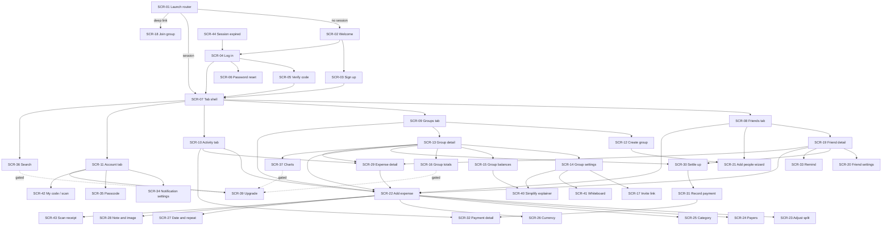

# Screens

> REA: one section per screen. Document what the user sees and can do, not how it is coded.

**Evidence basis:** static only. Screen names come from activity, fragment and layout names in the reference APK; fields and validation come from layout names and string-resource meaning. Nothing was observed running (no emulator). Visual layout, field order and copy are **our design**, not the reference app's. The SCR numbering is ours. F-xx refers to `features.md`.

Common states for every list screen (they apply unless a screen says otherwise):
- **Loading:** skeleton rows appear within 100 ms; a spinner appears after 300 ms if there is still no data.
- **Error:** an inline banner with Retry; cached data stays visible underneath.
- **Offline (V2, F-53):** cached data plus an "offline" banner; write actions are queued.

## Navigation overview
The root is a bottom tab bar with 4 tabs: **Friends, Groups, Activity, Account**. A floating "Add expense" button shows on Friends, Groups and Activity, and on the group and friend detail screens. Every detail screen is a stack push on its tab. Pickers (category, currency, date, payer, split) are modal screens over Add expense. Auth is its own stack before the tabs. The reference app's structure: one dashboard activity hosting tab fragments, plus separate activities for add expense, add payment, invites and passcode, observed (static).

---

## SCR-01: Launch router
- **Purpose:** Decide where the app opens: welcome, tabs, or a deep-link target.
- **Reached from:** app icon, push notification, app link
- **Related features:** F-04, F-54

**Fields / UI elements**
| Element | Type | Required | Validation / notes |
|---|---|---|---|
| App mark | image | – | our own branding |

**Actions**
| Action | Result | Navigates to |
|---|---|---|
| Valid refresh token | refresh, load `/users/me` | SCR-07, or the deep-link target |
| No token / refresh 401 | clear storage | SCR-02 |
| Deep link while logged out | store the link, continue after login | SCR-02 → target |
| Passcode on (F-50) | lock first | SCR-35 |

**States:** shown at most 2 s; after 10 s with no network the app goes to SCR-07 using cached data (V2) or shows an error with Retry (MVP).
**Evidence:** splash activity with the MAIN launcher and app-link intent filters, observed (static).

---

## SCR-02: Welcome (logged out)
- **Purpose:** Entry for new and returning users.
- **Reached from:** SCR-01, log out
- **Related features:** F-01, F-03, F-06

**Fields / UI elements**
| Element | Type | Required | Validation / notes |
|---|---|---|---|
| Sign up | button | – | → SCR-03 |
| Log in | button | – | → SCR-04 |
| Continue with Google | button | – | V2 |

**Actions**
| Action | Result | Navigates to |
|---|---|---|
| Tap Sign up | – | SCR-03 |
| Tap Log in | – | SCR-04 |
| Tap Google (V2) | OAuth → `/auth/google` (**not yet in the contract**; deferred, see tasks.md) | SCR-07 |

**States:** no loading state; an error toast if Google is cancelled.
**Evidence:** logged-out home activity observed (static).

---

## SCR-03: Sign up
- **Purpose:** Create an account.
- **Reached from:** SCR-02
- **Related features:** F-01, F-02

**Fields / UI elements**
| Element | Type | Required | Validation / notes |
|---|---|---|---|
| Full name | text | yes | 1–100 chars after trimming |
| Email | email | yes | RFC-style check, lower-cased, ≤ 254 chars |
| Password | password + show toggle | yes | ≥ 8 chars, ≤ 128 |
| Strength meter | 4-level bar | – | V2 (F-02) |
| Default currency | picker | yes | defaults from the device locale (INR for en-IN) |

**Actions**
| Action | Result | Navigates to |
|---|---|---|
| Tap Sign up (valid) | POST `/auth/register` → 201 | SCR-07 |
| Tap Sign up (invalid) | inline errors, no request | – |
| 409 response | "email already registered" under the email field | – |

**States:** button spinner while submitting; inputs disabled.
**Evidence:** signup fragment and layout, password-length rule and strength strings observed (static).

---

## SCR-04: Log in
- **Purpose:** Authenticate an existing user.
- **Reached from:** SCR-02, SCR-44
- **Related features:** F-03, F-05

**Fields / UI elements**
| Element | Type | Required | Validation / notes |
|---|---|---|---|
| Email | email | yes | non-empty |
| Password | password | yes | non-empty |
| Forgot password | link | – | → request reset |

**Actions**
| Action | Result | Navigates to |
|---|---|---|
| Tap Log in | POST `/auth/login` | SCR-07, or SCR-05 if a challenge is required |
| 401 | combined "email or password incorrect" | – |
| 429 | "too many attempts, try in 15 min" | – |
| Tap Forgot password | POST `/auth/password-reset` → 202 | confirmation toast |

**States:** submitting spinner; offline shows "can't reach server".
**Evidence:** login fragment and layout, error strings observed (static).

---

## SCR-05: Verify code (login challenge)
- **Purpose:** Second step for risky logins.
- **Reached from:** SCR-04
- **Related features:** F-07 (Later)

**Fields / UI elements**
| Element | Type | Required | Validation / notes |
|---|---|---|---|
| Delivery choice | radio (email / SMS) | yes | – |
| Code | 6-digit numeric | yes | exactly 6 digits |
| Contact support | link | – | – |

**Actions**
| Action | Result | Navigates to |
|---|---|---|
| Request code | code sent | stays |
| Submit code | tokens issued | SCR-07 |
| 5 wrong codes | locked | SCR-04 |

**States:** resend disabled for 30 s after each send.
**Evidence:** three login-challenge fragments observed (static).

---

## SCR-06: Password reset
- **Purpose:** Set a new password from an email link.
- **Reached from:** reset link (deep link)
- **Related features:** F-05

**Fields / UI elements**
| Element | Type | Required | Validation / notes |
|---|---|---|---|
| New password | password | yes | ≥ 8 chars |

**Actions**
| Action | Result | Navigates to |
|---|---|---|
| Save | POST `/auth/password-reset/confirm` | SCR-07 |
| 410 | "link expired" + request a new one | SCR-04 |

**States:** submitting spinner.
**Evidence:** reset-link handling activity and layout observed (static).

---

## SCR-07: Tab shell
- **Purpose:** Hosts the 4 root tabs and the add-expense button.
- **Reached from:** SCR-01, SCR-03, SCR-04
- **Related features:** all

**Fields / UI elements**
| Element | Type | Required | Validation / notes |
|---|---|---|---|
| Tab bar | 4 tabs | – | Friends, Groups, Activity, Account; the last tab is remembered |
| Add expense | floating button | – | hidden on Account |
| Search icon | icon | – | V2, gated (F-47) |
| Activity badge | counter | – | `unread_count` from `GET /activity` (decided 2026-11-09, OQ-36); the server does not cap it, the client shows the number up to 99 and "99+" above 99; hidden at 0. Refreshed on launch, on foreground and after `POST /activity/read`; opening the Activity tab (SCR-10) calls `POST /activity/read` and sets the badge to 0 |

**Actions**
| Action | Result | Navigates to |
|---|---|---|
| Tap a tab | switch | SCR-08/09/10/11 |
| Tap Add expense | opens with context (current group/friend if any) | SCR-22 |
| Tap Search | – | SCR-36 or SCR-39 |

**States:** n/a (container).
**Evidence:** dashboard activity, tab wrapper fragment, root-tab navigation keys and a friends/groups toolbar layout observed (static).

---

## SCR-08: Friends tab
- **Purpose:** All friends with the net balance with each, and an overall summary.
- **Reached from:** SCR-07
- **Related features:** F-08, F-09

**Fields / UI elements**
| Element | Type | Required | Validation / notes |
|---|---|---|---|
| Overall summary | text | – | per currency: "you owe X" / "you are owed Y" / both / "settled up" |
| Filter | menu | – | all / outstanding / owe me / I owe |
| Friend row | avatar, name, balance per currency, per-group breakdown | – | green when owed to the user, orange when the user owes (our colours) |
| Settled-up collapse row | row | – | "show N settled-up friends", for friends at 0 for > 30 days |
| Add friend | button | – | → SCR-21 |

**Actions**
| Action | Result | Navigates to |
|---|---|---|
| Tap a friend | – | SCR-19 |
| Change filter | list filtered on the client from the cached `GET /friends` response (`?filter=` also exists server-side) | – |
| Pull to refresh | GET `/friends` | – |

**States:** empty: illustration and "add your first friend". Filter with no results: "no friends match".
**Evidence:** friends-list fragment, balance-filter options, "currentuser balance overview" cell and settled-up texts observed (static).

---

## SCR-09: Groups tab
- **Purpose:** All groups with the user's balance in each.
- **Reached from:** SCR-07
- **Related features:** F-12, F-32

**Fields / UI elements**
| Element | Type | Required | Validation / notes |
|---|---|---|---|
| Overall summary | text | – | same as SCR-08 |
| Group row | avatar, name, user's balance per currency, top 2 member-level lines | – | – |
| "Non-group expenses" row | row | – | the user's non-group total |
| Settled-up collapse | row | – | groups at 0 for > 30 days |
| Start a new group | button | – | → SCR-12 |

**Actions**
| Action | Result | Navigates to |
|---|---|---|
| Tap a group | – | SCR-13 |
| Tap non-group row | – | SCR-19-like list of non-group expenses |
| Tap Start new group | – | SCR-12 |

**States:** empty: "create a group for your home, trip or partner".
**Evidence:** groups list cells, group balance filter options and the "all other groups" balance label observed (static).

---

## SCR-10: Activity tab
- **Purpose:** Chronological feed of events that involve the user.
- **Reached from:** SCR-07
- **Related features:** F-36

**Fields / UI elements**
| Element | Type | Required | Validation / notes |
|---|---|---|---|
| Activity row | icon, actor + verb + object, effect ("you owe 30.00"), relative time | – | unread rows bold |
| Date headers | section header | – | Today / Yesterday / date |

**Actions**
| Action | Result | Navigates to |
|---|---|---|
| Tap expense item | – | SCR-29 |
| Tap payment item | – | SCR-32 |
| Tap group item | – | SCR-13 |
| Scroll to end | GET `/activity?cursor=` (50 per page) | – |

**States:** empty: "no activity yet". A deleted object shows a "deleted" label with Restore on its detail screen.
**Evidence:** recent-activity screen, header and empty-view layouts observed (static).

---

## SCR-11: Account tab
- **Purpose:** Profile and app settings.
- **Reached from:** SCR-07
- **Related features:** F-03, F-46, F-50, F-51

**Fields / UI elements**
| Element | Type | Required | Validation / notes |
|---|---|---|---|
| Avatar | image picker | no | JPEG/PNG ≤ 5 MB |
| Name | text | yes | 1–100 |
| Email | email | yes | unique |
| Phone | phone (E.164) | no | country picker |
| Default currency | picker → SCR-26 | yes | ISO 4217 |
| Time zone | picker | yes | IANA name; defaults from the device |
| Notifications | row | – | → SCR-34 |
| Passcode | row | – | → SCR-35 (V2) |
| My code | row | – | → SCR-42 (V2) |
| Plan | row | – | "Free" or "Premium until <date>" → SCR-39 |
| Log out | button | – | confirmation dialog |
| Delete account | button | – | OQ-D5 |

**Actions**
| Action | Result | Navigates to |
|---|---|---|
| Edit a field | PATCH `/users/me` | – |
| Log out → confirm | revoke the refresh token, clear storage | SCR-02 |

**States:** saving indicator per field; 409 on an email clash shows inline.
**Evidence:** account fragment and layout, avatar helper, country picker, device settings and billing fragment observed (static).

---

## SCR-12: Create group
- **Purpose:** Name a new group, pick its type and add members.
- **Reached from:** SCR-09
- **Related features:** F-12

**Fields / UI elements**
| Element | Type | Required | Validation / notes |
|---|---|---|---|
| Group name | text | yes | 1–100 chars |
| Group image | image picker | no | ≤ 5 MB |
| Type | segmented: home / trip / couple / other | yes | default other |
| Trip dates | date range | no | only for trip; end ≥ start |
| Members | chips → SCR-21 | no | 0–199 other members; 200 members in total including the creator (**decision**, D6) |
| Simplify debts | switch | – | default on (OQ-09) |

**Actions**
| Action | Result | Navigates to |
|---|---|---|
| Tap Done | POST `/groups` | SCR-13 |
| Tap Add members | – | SCR-21 |
| Back with unsaved input | "discard?" dialog | SCR-09 |

**States:** submitting spinner.
**Evidence:** setup-group fragment, first-launch layout, type and trip strings observed (static).

---

## SCR-13: Group detail
- **Purpose:** One group's expenses and the user's position in it.
- **Reached from:** SCR-09, SCR-10, deep link
- **Related features:** F-18, F-30, F-32, F-34

**Fields / UI elements**
| Element | Type | Required | Validation / notes |
|---|---|---|---|
| Header | name, image, user's balance lines per member | – | at most 3 lines, then "+N more" |
| Action row | buttons: Settle up, Balances, Totals, Charts, Export | – | Totals, Charts and Export gated (F-46) |
| Timeline list | rows grouped by month: date, description, payer + amount, user's effect | – | one list from `GET /groups/{id}/timeline` (decided 2026-11-09, OQ-35): items with `kind: expense` render as expense rows, `kind: settlement` as payment rows (styled differently); no client-side merging; infinite scroll with `next_cursor` |
| Settled-up marker | row | – | "everything before this date is settled; tap to show" |
| Add expense | floating button | – | prefilled with this group |

**Actions**
| Action | Result | Navigates to |
|---|---|---|
| Tap expense | – | SCR-29 |
| Tap payment | – | SCR-32 |
| Tap Settle up | – | SCR-30 (group scope) |
| Tap Balances | – | SCR-15 |
| Tap Totals | – | SCR-16 or SCR-39 |
| Tap settings icon | – | SCR-14 |
| Scroll to end | GET `/groups/{id}/timeline?cursor=` | – |

**States:** empty with 1 member: "add people" button. Empty with members: "no expenses yet". All settled: "you are all settled up in this group".
**Evidence:** group screen and layout, add-people button layout, no-members and settled-up views observed (static).

---

## SCR-14: Group settings
- **Purpose:** Manage the group.
- **Reached from:** SCR-13
- **Related features:** F-13 to F-17, F-27, F-41, F-42, F-44, F-45, F-52

**Fields / UI elements**
| Element | Type | Required | Validation / notes |
|---|---|---|---|
| Name, image, type | editable cells | yes | as SCR-12 |
| Members list | rows with balance; "remove" on each | – | remove refused if the balance ≠ 0 |
| Add people | row | – | → SCR-21 |
| Invite via link | row | – | → SCR-17 |
| Simplify debts | switch + info | – | → SCR-40 |
| Default split (personal) | row | – | V2, F-27 |
| Whiteboard | row | – | → SCR-41 (Later) |
| Premium section | settle-up reminders, balance alert, convert currency, export | – | gated |
| Leave group | destructive | – | refused if the balance ≠ 0. After a successful leave the other members stay in the user's friend list (OQ-37a); optional one-line hint in the confirm dialog: "You will stay friends with the other members." |
| Delete group | destructive | – | 2-step confirmation. Members stay in each other's friend lists (OQ-37a); optional hint in the second step: "Members stay on your friends list." After a leave or delete the client invalidates the friends query (`listFriends`, `getFriend`) |

**Actions**
| Action | Result | Navigates to |
|---|---|---|
| Toggle simplify | PATCH `/groups/{id}` | – |
| Remove member | DELETE `/groups/{id}/members/{user_id}` | – |
| Leave | DELETE `/groups/{id}/members/me` | SCR-09 |
| Delete | DELETE `/groups/{id}` | SCR-09 |

**States:** 409 `OUTSTANDING_BALANCE` → dialog naming the amounts owed.
**Evidence:** group settings fragment and dialog, settings cells (name, icon, simplify, Pro header, Pro button) observed (static).

---

## SCR-15: Group balances
- **Purpose:** Every member's net balance, and the suggested payments.
- **Reached from:** SCR-13
- **Related features:** F-17, F-32, F-33

**Fields / UI elements**
| Element | Type | Required | Validation / notes |
|---|---|---|---|
| Member row | avatar, "gets back X in total" / "owes X in total" per currency | – | nets sum to 0 per currency |
| Expanded row | list of "A owes B X" | – | from simplified or pairwise mode |
| Mode note | text | – | "simplify debts is on/off" + info link |
| Remind / Settle | buttons on each line | – | → SCR-33 / SCR-31 |

**Actions**
| Action | Result | Navigates to |
|---|---|---|
| Tap a row | expand | – |
| Tap Settle on a line | prefilled payment | SCR-31 |
| Tap info | – | SCR-40 |

**States:** all zero: "everyone is settled up".
**Evidence:** group-balances screen, list, cells and repayments cell, simplify overlay observed (static).

---

## SCR-16: Group totals (premium)
- **Purpose:** Spending summary for a period.
- **Reached from:** SCR-13
- **Related features:** F-48

**Fields / UI elements**
| Element | Type | Required | Validation / notes |
|---|---|---|---|
| Period | picker: this month / last month / this year / all time / custom range | yes | custom end ≥ start |
| Total group spending | money per currency | – | payments excluded |
| Your share | money per currency | – | – |
| Total you paid | money per currency | – | – |

**Actions**
| Action | Result | Navigates to |
|---|---|---|
| Change period | GET `/groups/{id}/totals?from=&to=` (Later; **not yet in the contract**) | – |

**States:** free user → SCR-39.
**Evidence:** group totals screen and layout, date-range picker modal observed (static).

---

## SCR-17: Group invite link
- **Purpose:** Share or reset the group's join link.
- **Reached from:** SCR-14
- **Related features:** F-13

**Fields / UI elements**
| Element | Type | Required | Validation / notes |
|---|---|---|---|
| Link | read-only text | – | – |
| Copy / Share | buttons | – | share sheet |
| Reset link | button | – | confirmation dialog |
| Warning | text | – | "anyone with the link can join" |

**Actions**
| Action | Result | Navigates to |
|---|---|---|
| Reset | POST `/groups/{id}/invite-link` (new token) | – |

**States:** loading while the token is fetched.
**Evidence:** group invite link activity and layout observed (static).

---

## SCR-18: Join group (invite acceptance)
- **Purpose:** Join a group from a link, optionally claiming a placeholder member.
- **Reached from:** deep link
- **Related features:** F-13

**Fields / UI elements**
| Element | Type | Required | Validation / notes |
|---|---|---|---|
| Group name and members | header | – | – |
| Placeholder list | single-select | no | members without an account |
| "I'm not on this list" | option | – | – |

**Actions**
| Action | Result | Navigates to |
|---|---|---|
| Join | POST `/groups/join` | SCR-13 |
| 410 | "invite no longer valid" | SCR-07 |
| Logged in as a different email than invited | "merge accounts?" dialog | – |

**States:** loading the invite preview (needs a preview endpoint that is **not yet in the contract**; progress.md, decision D-C).
**Evidence:** group invite acceptance fragment and list item, the not-in-list layout and merge-accounts layout observed (static).

---

## SCR-19: Friend detail
- **Purpose:** Everything shared with one friend.
- **Reached from:** SCR-08, SCR-10
- **Related features:** F-08, F-31, F-34, F-39

**Fields / UI elements**
| Element | Type | Required | Validation / notes |
|---|---|---|---|
| Header | name, total balance per currency, breakdown by group + non-group | – | – |
| Actions | Settle up, Remind, Charts, Export | – | Charts and Export gated |
| Expense list | shared expenses across all groups and non-group, grouped by month | – | group name tag on each row |

**Actions**
| Action | Result | Navigates to |
|---|---|---|
| Settle up | – | SCR-30 (friend scope) |
| Remind | – | SCR-33 |
| Settings icon | – | SCR-20 |
| Tap expense | – | SCR-29 |

**States:** empty: "no expenses with this friend". Settled: "you are settled up".
**Evidence:** friendship screen and friend screen layout, the in-group / non-group balance labels observed (static).

---

## SCR-20: Friend settings
- **Purpose:** Manage one friendship.
- **Reached from:** SCR-19
- **Related features:** F-11, F-44, F-45

**Fields / UI elements**
| Element | Type | Required | Validation / notes |
|---|---|---|---|
| Shared groups | list | – | tap → SCR-13 |
| Remove friend | destructive | – | refused while there are shared groups, even if an explicit friendship exists; the 409 dialog lists the groups and says to leave them first. Once the last shared group has ended the person is an explicit friend and removal is allowed (OQ-33, OQ-37a). The app never needs to tell the user a friend was kept: no toast or notice is shown when a group ends. **Never blocked by a balance (OQ-32):** the confirmation dialog must warn that non-group expenses, non-group payments and any balance with this person will be deleted (OQ-37b), showing the current non-group balance if non-zero |
| Block | destructive | – | V2 |
| Convert non-group to default currency | row | – | Later, gated |

**Actions**
| Action | Result | Navigates to |
|---|---|---|
| Remove → warning dialog → confirm | DELETE `/friends/{user_id}` | SCR-08 |
| 409 shared groups | dialog listing the groups | – |

**States:** n/a.
**Evidence:** friendship settings layout and shared-groups cell observed (static).

---

## SCR-21: Add people wizard
- **Purpose:** Pick friends or contacts, or type a new person, to add as friends or to a group.
- **Reached from:** SCR-08, SCR-12, SCR-14, SCR-22
- **Related features:** F-09

**Fields / UI elements**
| Element | Type | Required | Validation / notes |
|---|---|---|---|
| Search | text | – | matches friends and device contacts |
| Selected chips | chips | – | removable |
| Friend / contact rows | multi-select | – | contacts only after permission is granted |
| Add new contact | form: name, email or phone | yes | valid email or E.164 phone |
| Verify contact | confirm screen | – | shows the email/phone that will get the invite |

**Actions**
| Action | Result | Navigates to |
|---|---|---|
| Done | POST `/friends` per new person and/or POST `/groups/{id}/members` | back to caller |
| Contacts permission denied | contacts list hidden, a primer explains why | – |

**States:** empty search: "add '<text>' as a new contact".
**Evidence:** select-people wizard with choose / add / edit / verify fragments, the contact detail rows and the permission primer overlay observed (static).

---

## SCR-22: Add / edit expense
- **Purpose:** Create or edit an expense.
- **Reached from:** Add expense button (SCR-07/13/19), SCR-29 (edit), share-image intent
- **Related features:** F-18 to F-31, F-40, F-43

**Fields / UI elements**
| Element | Type | Required | Validation / notes |
|---|---|---|---|
| With you and | token field (friends + at most 1 group) | yes | ≥ 1 other person unless a group is chosen |
| Description | text | yes | 1–200 chars |
| Category button | icon → SCR-25 | no | default uncategorized |
| Currency button | code → SCR-26 | yes | default = group currency, else the user's |
| Amount | money input | yes | 1 ≤ amount_minor ≤ 9,999,999,999 (99,999,999.99 in a 2-decimal currency), decimals ≤ the currency exponent |
| Paid by / split summary | tappable sentence "paid by X and split Y" | yes | → SCR-24 / SCR-23 |
| Date | chip → SCR-27 | yes | default today |
| Group chip | chip | no | change group |
| Note / image | chip → SCR-28 | no | – |
| Repeat | chip → SCR-27 | no | V2 |
| Scan receipt | button | no | Later, gated |

**Actions**
| Action | Result | Navigates to |
|---|---|---|
| Save (new) | POST `/groups/{id}/expenses`, or `/expenses` with `group_id=null` | caller, plus a toast |
| Save (edit) | PATCH `/expenses/{id}` with `version` | SCR-29 |
| Save with invalid split | error dialog with the exact gap (for example "under by 10.00") | SCR-23 |
| Back with changes | "discard changes?" | caller |

**States:** saving spinner; offline → saved to the queue with an "unsynced" badge (V2).
**Evidence:** add expense screen and layout, add-detail fragments, the "and split" sentence, the expense-added confirmation activity and the shared-image intent filter observed (static).

---

## SCR-23: Adjust split
- **Purpose:** Choose how the cost is divided.
- **Reached from:** SCR-22
- **Related features:** F-20 to F-25

**Fields / UI elements**
| Element | Type | Required | Validation / notes |
|---|---|---|---|
| Two-person options | 4 choices | – | only when 2 people are involved |
| Tabs | equal / exact / percent / shares / adjustment | yes | – |
| Person row (equal) | checkbox + computed amount | ≥ 1 checked | – |
| Person row (exact) | money input | – | footer: "X of Y", "Z left" or "over by Z" |
| Person row (percent) | 0–100, 2 dp | – | footer: "X% of 100%", "Y% left" |
| Person row (shares) | integer 0–999 | ≥ 1 non-zero | footer: "N total shares" |
| Person row (adjustment) | money input ≥ 0 | – | each row shows its computed amount |

**Actions**
| Action | Result | Navigates to |
|---|---|---|
| Done (valid) | split saved to the draft | SCR-22 |
| Done (invalid) | error naming the gap | – |

**States:** amounts recompute on every keystroke in < 16 ms (pure client function shared with tests).
**Evidence:** split choices fragment, five split-type fragments, split cells and header observed (static).

---

## SCR-24: Payers
- **Purpose:** Choose one payer or enter several paid amounts.
- **Reached from:** SCR-22
- **Related features:** F-26

**Fields / UI elements**
| Element | Type | Required | Validation / notes |
|---|---|---|---|
| Person list | single-select | yes | – |
| Multiple people | option → amount per person | – | sum must equal the total; footer "X of Y" |

**Actions**
| Action | Result | Navigates to |
|---|---|---|
| Pick one | payer set to the full total | SCR-22 |
| Multiple → Done | payers saved, or "under/over by X" | SCR-22 |

**States:** n/a.
**Evidence:** payer chooser and multiple-payers fragments, payer cell observed (static).

---

## SCR-25: Category picker
- **Purpose:** Pick a category.
- **Reached from:** SCR-22
- **Related features:** F-19

| Element | Type | Required | Validation / notes |
|---|---|---|---|
| Search | text | – | case-insensitive substring |
| Sections | parent headings with child rows (icon + name) | – | – |

| Action | Result | Navigates to |
|---|---|---|
| Tap a child | category set | SCR-22 |

**States:** no results: "no matching category".
**Evidence:** category chooser and search-chooser layout observed (static).

---

## SCR-26: Currency picker
- **Purpose:** Pick an ISO 4217 currency.
- **Reached from:** SCR-22, SCR-11, SCR-12
- **Related features:** F-43, F-51

| Element | Type | Required | Validation / notes |
|---|---|---|---|
| Search | text | – | matches code and name |
| Recent | section | – | the user's last 3 currencies |
| All | list: code, name, symbol | – | – |

| Action | Result | Navigates to |
|---|---|---|
| Tap a currency | set | back |

**States:** no results view.
**Evidence:** currency chooser, select-currency cell and no-results layout observed (static).

---

## SCR-27: Date and repeat
- **Purpose:** Set the expense date and the repeat rule.
- **Reached from:** SCR-22
- **Related features:** F-18, F-40

| Element | Type | Required | Validation / notes |
|---|---|---|---|
| Date | calendar | yes | 2000-01-01 to today + 365 days (**decision**) |
| Repeat | never / weekly / fortnightly / monthly / yearly | yes | default never |
| Reminder | off / on the day / 1, 2, 3 or 7 days before | no | only when repeating (OQ-22) |

| Action | Result | Navigates to |
|---|---|---|
| Done | values saved to the draft | SCR-22 |

**States:** n/a.
**Evidence:** date picker fragment, repeat strings and reminder texts observed (static).

---

## SCR-28: Note and image
- **Purpose:** Add notes and a receipt image.
- **Reached from:** SCR-22
- **Related features:** F-28

| Element | Type | Required | Validation / notes |
|---|---|---|---|
| Note | multiline text | no | ≤ 2000 chars |
| Image | camera / gallery / remove | no | JPEG/PNG ≤ 10 MB, croppable |

| Action | Result | Navigates to |
|---|---|---|
| Done | saved to the draft | SCR-22 |
| Remove image | confirmation | – |

**States:** upload progress bar on save.
**Evidence:** note-entry and edit-image fragments, crop activity observed (static).

---

## SCR-29: Expense detail
- **Purpose:** View an expense, its splits and comments.
- **Reached from:** SCR-10, SCR-13, SCR-19
- **Related features:** F-29, F-30, F-37

| Element | Type | Required | Validation / notes |
|---|---|---|---|
| Header | category icon, description, total + currency, date, "added by X on D", "updated by Y on D" | – | – |
| Payer lines | "X paid Y" | – | – |
| Split lines | "X owes Y" for each participant | – | – |
| Receipt thumbnail | image | – | tap → full screen |
| Notes | text | – | – |
| Comments | list (own / other / system) | – | – |
| Comment bar | text + send | – | 1–1000 chars |
| Deleted banner | "deleted by X on D" + Restore | – | – |

| Action | Result | Navigates to |
|---|---|---|
| Edit | – | SCR-22 (edit) |
| Delete → confirm | DELETE `/expenses/{id}` | stays, banner shown |
| Restore | POST `/expenses/{id}/restore` | – |
| Send comment | POST `/expenses/{id}/comments` | – |

**States:** a 404 for a removed expense → "cannot find expense" and back.
**Evidence:** expense details fragment, top section, comment cells, charts cell and comment bar observed (static).

---

## SCR-30: Settle up (choose balance)
- **Purpose:** Pick who pays whom and for which balance.
- **Reached from:** SCR-13, SCR-19, SCR-15
- **Related features:** F-34

| Element | Type | Required | Validation / notes |
|---|---|---|---|
| Payer | person chooser | yes | default: the current user if they owe |
| Balance list | rows per counterparty and currency | yes | – |
| Settle all | row | – | when the friend has balances in several scopes |
| Already paid? | hint | – | – |

| Action | Result | Navigates to |
|---|---|---|
| Tap a row | – | SCR-31 prefilled |

**States:** no balances: "you are settled up".
**Evidence:** payment balance chooser and person chooser fragments and their cells observed (static).

---

## SCR-31: Record payment
- **Purpose:** Enter the payment details and save.
- **Reached from:** SCR-30, SCR-15
- **Related features:** F-34

| Element | Type | Required | Validation / notes |
|---|---|---|---|
| From → To | two avatars, swappable | yes | from ≠ to |
| Amount | money | yes | 1 ≤ amount_minor ≤ 9,999,999,999 |
| Currency | code | yes | default = the balance's currency |
| Date | date | yes | default today |
| Group | chip | no | null = non-group |
| Note | text | no | ≤ 500 |

| Action | Result | Navigates to |
|---|---|---|
| Save | POST `/settlements` | caller |
| Amount > balance | "this is more than owed" confirmation | – |

**States:** submitting spinner.
**Evidence:** record payment fragment and screen layout observed (static).

---

## SCR-32: Payment detail
- **Purpose:** View, edit, delete or restore a payment.
- **Reached from:** SCR-10, SCR-13
- **Related features:** F-35

| Element | Type | Required | Validation / notes |
|---|---|---|---|
| Summary | "X paid Y amount" + date + group | – | – |
| Edit / Delete / Restore | buttons | – | – |

| Action | Result | Navigates to |
|---|---|---|
| Edit | – | SCR-31 (edit) |
| Delete → confirm | DELETE `/settlements/{id}` | – |
| Restore | POST `/settlements/{id}/restore` | – |

**States:** deleted banner.
**Evidence:** payment details fragment and sections, edit-payment layout observed (static).

---

## SCR-33: Remind
- **Purpose:** Send a reminder about a balance.
- **Reached from:** SCR-19, SCR-15
- **Related features:** F-39

| Element | Type | Required | Validation / notes |
|---|---|---|---|
| Recipient(s) | read-only | – | – |
| Message | multiline, prefilled with the amount | no | ≤ 1000 |
| Send via app / Share | 2 buttons | – | – |

| Action | Result | Navigates to |
|---|---|---|
| Send via app | POST `/reminders` | back + toast |
| 429 | "wait 1 minute" | – |
| Share | share sheet with the text | – |

**States:** sending spinner.
**Evidence:** remind screen, send-reminder dialog layouts and broadcast receiver observed (static).

---

## SCR-34: Notification settings
- **Purpose:** Turn notification types on or off.
- **Reached from:** SCR-11
- **Related features:** F-38

| Element | Type | Required | Validation / notes |
|---|---|---|---|
| 10 type switches | switch | – | the types listed in F-38 |
| Email digest | switch | – | V2 |

| Action | Result | Navigates to |
|---|---|---|
| Toggle | PATCH `/users/me` `notification_prefs` | – |

**States:** if the OS permission is denied, a banner links to system settings.
**Evidence:** device settings activity and screen layout, notification-channel strings observed (static).

---

## SCR-35: Passcode
- **Purpose:** Set, change or enter the app passcode.
- **Reached from:** SCR-11, app resume
- **Related features:** F-50

| Element | Type | Required | Validation / notes |
|---|---|---|---|
| 4-digit pad | keypad | yes | exactly 4 digits (OQ-20) |
| Biometric prompt | system | – | if enrolled |
| Timeout | immediately / 1 / 5 / 15 min | – | – |

| Action | Result | Navigates to |
|---|---|---|
| Correct code | unlock | previous screen |
| 5 wrong codes | 30 s lockout | – |

**States:** n/a.
**Evidence:** passcode activity, lock screen layout, fingerprint dialog observed (static).

---

## SCR-36: Search / all expenses (premium)
- **Purpose:** Find expenses.
- **Reached from:** SCR-07, SCR-19
- **Related features:** F-47

| Element | Type | Required | Validation / notes |
|---|---|---|---|
| Query | text | yes | ≥ 2 chars before searching |
| Results | expense rows | – | 25 per page |

| Action | Result | Navigates to |
|---|---|---|
| Type | GET `/expenses?q=` (300 ms debounce) | – |
| Tap a result | – | SCR-29 |

**States:** no results; free user → SCR-39.
**Evidence:** all-expenses screen, search menu and friend-search strings observed (static).

---

## SCR-37: Charts (premium)
- **Purpose:** Spending by category and by month.
- **Reached from:** SCR-13, SCR-19
- **Related features:** F-48

| Element | Type | Required | Validation / notes |
|---|---|---|---|
| Period | picker | yes | as SCR-16 |
| By-category bar chart | chart | – | the user's share by default; toggle to group total |
| By-month bar chart | chart | – | last 12 months |

| Action | Result | Navigates to |
|---|---|---|
| Change period | GET `/groups/{id}/totals` | – |

**States:** free user → SCR-39; empty: "no spending in this period".
**Evidence:** charts screen title and charts cell on expense details observed (static). The reference app may render charts in a web view (OQ-23).

---

## SCR-38: Export sheet (premium)
- **Purpose:** Produce and share a CSV.
- **Reached from:** SCR-13, SCR-19, SCR-14
- **Related features:** F-45

| Element | Type | Required | Validation / notes |
|---|---|---|---|
| Scope | read-only (group or friend) | – | – |
| Progress | "generating" | – | – |

| Action | Result | Navigates to |
|---|---|---|
| Start | POST `/exports` then poll GET `/exports/{id}` | share sheet |

**States:** failure → retry.
**Evidence:** export and generating-spreadsheet strings observed (static).

---

## SCR-39: Upgrade (paywall)
- **Purpose:** Explain premium and start a purchase.
- **Reached from:** any gated action, SCR-11
- **Related features:** F-46

| Element | Type | Required | Validation / notes |
|---|---|---|---|
| Benefits list | rows | – | – |
| Plans | monthly / yearly with a saving % | yes | prices from Play Billing |
| Restore purchases | link | – | – |
| Close / wait timer | button | – | only for the expense-limit variant (OQ-19) |

| Action | Result | Navigates to |
|---|---|---|
| Buy | Play Billing → verify the purchase on the server (`/subscriptions/verify` is **not yet in the contract**; progress.md, decision D-C) | back with the feature unlocked |
| Restore | query purchases | toast "restored" or "none found" |

**States:** offline: "can't upgrade right now".
**Evidence:** native-ad modal with plan items and benefits, billing client fragment, restore strings and the "save N%" key observed (static).

---

## SCR-40: Simplify debts explainer
- **Purpose:** Explain debt simplification with a worked example.
- **Reached from:** SCR-14, SCR-15
- **Related features:** F-17

| Element | Type | Required | Validation / notes |
|---|---|---|---|
| Illustration | our own 3-person diagram | – | A→B 10, B→C 10 becomes A→C 10 |
| Turn on | button | – | only if currently off |

| Action | Result | Navigates to |
|---|---|---|
| Turn on | PATCH group | back |

**States:** n/a.
**Evidence:** simplify-debts explanation activity and video overlay layout observed (static).

---

## SCR-41: Whiteboard
- **Purpose:** Shared group notes.
- **Reached from:** SCR-14
- **Related features:** F-52 (Later)

| Element | Type | Required | Validation / notes |
|---|---|---|---|
| Text | multiline | no | ≤ 10000 chars |
| Last edited | "by X on D" | – | – |

| Action | Result | Navigates to |
|---|---|---|
| Save | PATCH `/groups/{id}` `whiteboard` | – |

**States:** n/a.
**Evidence:** whiteboard screen and layout observed (static).

---

## SCR-42: My code / scan code
- **Purpose:** Add friends in person.
- **Reached from:** SCR-11, SCR-08
- **Related features:** F-10 (V2)

| Element | Type | Required | Validation / notes |
|---|---|---|---|
| Tabs | My code / Scan | – | – |
| QR + link | image + share | – | – |
| Camera view | scanner | – | CAMERA permission |

| Action | Result | Navigates to |
|---|---|---|
| Scan a valid code | confirmation dialog → `POST /friends` with `friend_code`. The name shown in the dialog needs a code-lookup endpoint that is **not yet in the contract** (progress.md, decision D-C) | SCR-19 |

**States:** permission denied → explanation + settings link.
**Evidence:** scan code activity, pager adapter, my-code layout observed (static).

---

## SCR-43: Scan receipt and itemize (premium, Later)
- **Purpose:** Capture a receipt and assign its items.
- **Reached from:** SCR-22
- **Related features:** F-49

| Element | Type | Required | Validation / notes |
|---|---|---|---|
| Camera overlay | live scan | – | – |
| Detected total / merchant / date | editable | – | "not detected" fallback |
| Items list | name + amount, editable | ≥ 1 | each item name and amount required |
| Per-item people | multi-select | each item ≥ 1 person | – |
| Per-person totals | review | – | – |

| Action | Result | Navigates to |
|---|---|---|
| Confirm | split = exact amounts from the items | SCR-22 |
| Exit | "progress will be lost" | SCR-22 |

**States:** detection failure → continue manually or rescan.
**Evidence:** camera scan activity, live scan overlay, itemization wizard and review layouts observed (static).

---

## SCR-44: Session expired
- **Purpose:** Tell the user the session ended.
- **Reached from:** a failed refresh
- **Related features:** F-04

| Element | Type | Required | Validation / notes |
|---|---|---|---|
| Message + Log in button | – | – | – |

| Action | Result | Navigates to |
|---|---|---|
| Log in | – | SCR-04 (email prefilled) |

**States:** n/a.
**Evidence:** expired session activity and fragment observed (static).
